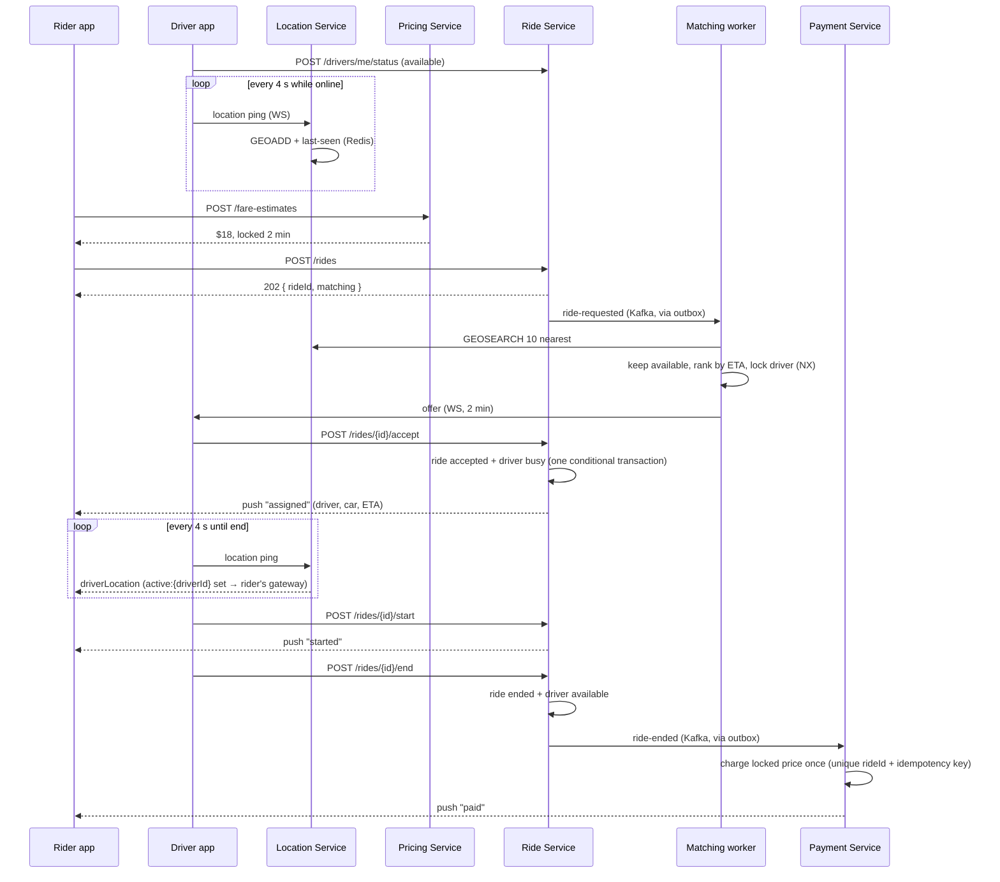

# Case 5: Uber (ride hailing)

Diagram: [case-05-uber.excalidraw](case-05-uber.excalidraw), in three rows: **A. Normal ride** (every path), **B. Hot spot: ride matching only** (a stadium lets out: 50k requests in 15 minutes, 2k drivers nearby; everything else is the same as A, plus surge in the estimate), and **C. Ride journey**. Both rows have the same requirements. Two clients (driver app, rider app) → **APIM** (tall box: auth, rate limit) → REST goes straight to the services; WebSocket traffic goes to the **WebSocket gateway** right after APIM (a pipe: it holds the sockets and stores no locations). Then a **write path** (top) and a **read path** (bottom). Row **C. Ride journey** shows the same flow in time order: rider app, services and driver app as three lanes. To view or edit it, open it at excalidraw.com (File → Open) or with the VS Code Excalidraw extension.

## Prompt (what the interviewer says)
> "Design Uber. Riders request a ride, and a nearby driver picks them up."

## Functional requirements (in scope; learner's list, 2026-11-20)
1. **Fare estimate:** the rider enters pickup and dropoff and sees a price. The price is **locked** for ~2 minutes and is what they pay.
2. **Request a ride:** the system finds the **nearest available drivers**.
3. **Assignment:** the nearest driver gets an **offer** with **2 minutes** to accept; on a decline or no answer, the next driver is tried. **One driver per ride, one ride per driver.**
4. **Live driver location:** once assigned, the rider sees the driver moving on the map until the ride ends.
5. **Payment at the end of the ride:** when the driver taps "end", the rider's card on file is charged the locked price.

**Supporting flows (needed, but not features):** drivers send their location every ~4 s (for 2 and 4); the driver taps accept / start / end (for 3, 4 and 5).

**Row B has the same requirements**, with surge: in a hot **zone** the estimate includes a surge multiplier. *(A zone = one hexagon on the map, about 1 km across; Uber's H3 grid under the hood.)*

**Out of scope (say this out loud):** trip history, ratings, cancellations, pooled and scheduled rides, metered fares, tips, adding a card (assume one is on file), driver payouts, maps and routing (an external Maps API gives routes and ETAs).

## Non-functional requirements
| Requirement | Target | Why it matters here |
|---|---|---|
| Matching time | First offer within ~5 s of the request; accept window 2 min per driver | A decline or no answer costs the rider up to 2 min per driver (see deep dive 8) |
| Location freshness | The rider's map lags the driver by ≤ ~5 s | Older is useless at pickup |
| Assignment consistency | One driver per ride, one ride per driver, always (CP for this step) | Double-booking a driver is the worst bug here |
| Payment correctness | Charged **exactly once in effect**: at-least-once delivery + an idempotency key | A double charge is a support ticket and a refund |
| Availability | Location ingest and tracking keep working (AP) | A dropped ping is fine; the next one comes in 4 s |
| Geography | Global, but every ride is **local to one city** | Shard by city / region |

## Capacity estimate (high level)
**Facts:** 25M rides/day; ~1M drivers online at peak, pinging every 4 s; average trip 20 min; peak = 3× average; 1 day ≈ 10⁵ s. Hot spot: 50k requests in 15 min in a few zones.

| What | Math | Result | So… |
|---|---|---|---|
| Location pings/s | 1M ÷ 4 s | **~250k/s** | The heaviest write; keep **latest only** in Redis, never a DB row per ping |
| Latest-location memory | 1M × ~100 B | **~100 MB** | Fits in RAM; shard by city for **write throughput**, not size |
| Ride requests/s | 25M ÷ 10⁵ | **250/s avg, ~1k/s peak** | Light; SQL is fine |
| Concurrent rides | 25M × 20 min ÷ 1,440 min | **~350k avg, ~1M peak** | ~250k location pushes/s to riders |
| Payments/s | 25M ÷ 10⁵ | **250/s avg, ~1k/s peak** | Light; the problem is correctness, not volume |
| Hot spot | 50k ÷ 900 s | **~55 requests/s in a few zones** | The rate is small; the problem is **contention** (many riders, few drivers) and **price** |

**What the numbers tell you:** location pings dominate (250k/s) and are only useful for seconds, so they live in memory and are overwritten. Requests and payments are rare by comparison; their difficulty is **correctness** (no double booking, no double charge). Every ride is local to a city, so the city is the shard key.

## API
**WebSocket** `wss://rt.example.com/ws` (JWT on connect; drivers while online, riders while a ride is active)

| Direction | Frame | Payload | Notes |
|---|---|---|---|
| Driver → server | `location` | `{ lat, lng, heading, ts }` every 4 s | Fire and forget |
| Server → driver | `offer` | `{ rideId, pickup, dropoff, price, expiresInSec: 120 }` | Driver answers with `POST /rides/{id}/accept` |
| Server → rider | `ride` | `{ rideId, status, driver?, etaSec }` | Matched, arriving, started, ended, paid |
| Server → rider | `driverLocation` | `{ lat, lng, heading }` every 4 s | Only while assigned / on the ride |

**REST**

| Endpoint | Request | Response | Notes |
|---|---|---|---|
| `POST /fare-estimates` | `{ pickup, dropoff }` | `200 { estimateId, price, surge, expiresAt }` | Price locked ~2 min |
| `POST /rides` | `{ estimateId }` + `Idempotency-Key` | `202 { rideId, status: matching }` | A double tap creates one ride; `410` if the estimate expired |
| `GET /rides/{id}` | — | `200 { status, driver?, etaSec, price, paymentStatus }` | Fallback after a WebSocket reconnect |
| `POST /rides/{id}/accept` (driver) | — | `200` · `409` (taken, expired, or you're busy) | The **one** contested write |
| `POST /drivers/me/status` (driver) | `{ status: available \| offline }` | `204` | Going online puts the driver in search; offline removes them at once |
| `POST /rides/{id}/start` · `/end` (driver) | `{ ts }` | `200` | `end` → `ride-ended` → payment |

There's no "pay" endpoint: the charge is triggered by `end`, server-side, with the card on file.

## High-level design (see the diagram)
**Services and stores:**
| Component | What it does | Store / technology |
|---|---|---|
| WebSocket gateway (behind APIM) | A pipe: holds driver sockets (and riders' during a ride); pings pass in, pushes pass out, nothing is stored. Registers `user → gateway node` in presence on connect | As in Case 2; ~200k sockets per node |
| Location Service | Takes pings; overwrites the latest position; if the driver has an active ride, pushes the position straight to that rider's gateway node | **Redis geo index** (`GEOADD drivers:{city}`); **Redis** `active:{driverId} → riderId` (written by the Ride Service) |
| Active rides (Redis) | Who is watching this driver: `active:{driverId} → riderId`. **Set once** by the Ride Service on accept, **deleted** on end | Redis; one `GET` per ping |
| Pricing Service | Estimate = route (Maps API) × rates × surge; stores the locked price | Maps API; surge multipliers in **Redis** |
| Ride Service | Create ride, accept, start, end | **Azure SQL, sharded by city**: `rides`, `drivers` (status), outbox |
| Matching worker | Nearest available drivers → rank by ETA → lock one → offer → wait up to 2 min → next | Kafka consumer of `ride-requested` (partitioned by city); **Redis** driver locks |
| Payment Service | On `ride-ended`, charges the locked price once | **Payments (SQL)**, `rideId` unique; card processor (Stripe / Adyen) |
| Surge (row B) | Requests vs. available drivers per zone every 30 s → multiplier | Kafka consumer → Redis |

**Write path:**
1. **Locations:** driver → WebSocket gateway → Location Service → `GEOADD drivers:{city}` (latest only) and `ZADD drivers:{city}:seen now driverId`. Members of a geo set **can't have their own TTL**, so a sweeper runs every few seconds: drivers not seen for 30 s are removed (`ZRANGEBYSCORE` on `:seen` → `ZREM` from both), so a vanished driver drops out of search. In row B it also sends one sample per driver every 30 s to Kafka for the surge counter.
2. **Request:** rider → `POST /rides` → Ride Service inserts `rides(status = matching, price = locked estimate)` + outbox → Kafka `ride-requested` → `202`.
3. **Match:** the matching worker runs `GEOSEARCH` (2 km, 10 nearest available), ranks by ETA, takes the best and **locks** it: `SET driver:{id}:offer rideId NX EX 130`. If the lock fails, another ride is offering to that driver, so try the next. Then it pushes the offer.
4. **Accept (the contested write):** one SQL transaction on the city shard:
   `UPDATE rides SET driver_id = @d, status = 'accepted' WHERE id = @r AND status = 'matching'` and
   `UPDATE drivers SET status = 'busy' WHERE id = @d AND status = 'available'`.
   Both must change exactly 1 row, else roll back and return `409`. **The Redis lock is a fast filter; this conditional update is the truth.** No answer in 2 min → the lock expires → next driver.
5. **Live location:** on every ping the Location Service does `GET active:{driverId}`. Not set (no ride) → done. Set → look up the rider's gateway node (presence) and push `driverLocation` straight out. **No Kafka on this path:** who should see the driver is decided once at accept, so there's nothing to fan out. A failed push is fine; the next ping comes in 4 s.
6. **End + pay:** the driver taps end → ride `ended` + outbox → Kafka `ride-ended` → Payment Service:
   1. insert `payments(rideId UNIQUE, amount, status = pending)`; a duplicate event hits the unique key and stops here;
   2. call the card processor with **idempotency key = rideId**;
   3. mark `paid` (or `failed` → retry with backoff, then flag the rider's account). The rider gets a `ride: paid` push.

**Read path:**
1. **Fare estimate:** Pricing Service → Maps API (route, ETA) × rates (× surge in row B) → returns and stores the locked price.
2. **Ride status:** Ride Service → SQL read replica. Live changes arrive by **push**; this GET is the fallback after a reconnect.

## Hot-spot ride matching (row B)
Only matching changes in a hot spot; estimate (plus surge), locations, live push, accept / start / end and payment work as in row A.

**Why greedy breaks:** in row A each request is matched on its own, the moment it arrives: nearest available driver, lock, offer. With 50k riders and 2k drivers in a few zones, hundreds of matchers race for the same few cars (lock failures, retries), and first-come grabs give poor pairs (a rider 50 m from driver X gets driver Y 900 m away because X was grabbed a second earlier by someone 800 m away).

**Batch matching, step by step:**
1. `POST /rides` → Rides (SQL) + outbox → Kafka `ride-requested` (partitioned by zone) → the rider is added to the **zone queue**: Redis sorted set `waiting:{zone}`, score = request time.
2. Every **2 s**, one **batch matcher per zone** (one Kafka partition = one owner, so no two matchers fight over a zone):
   1. takes the **N oldest** waiting riders;
   2. gets the **M available drivers** in the zone and its neighbour zones (geo index);
   3. builds an **N × M ETA matrix** (Maps API, cached per road segment);
   4. solves the **assignment**: the pairs with the lowest *total* ETA (Hungarian algorithm, or greedy on the sorted matrix when N × M is large), oldest riders first so nobody starves.
3. For each pair: driver lock (`NX`) + offer (2 min). **Accept** → the same conditional `UPDATE` as row A → assigned, rider removed from the queue.
4. **Decline / no answer** → the rider goes back into the queue **with their original request time**, so they keep their place.
5. **Unmatched riders** (more riders than drivers) simply stay queued for the next tick; `GET /rides/{id}` shows their position (`ZRANK`).

**Trade-off:** each rider waits up to 2 s longer before the first offer, in exchange for better pairs overall and no lock stampede. Use batching only in dense zones (e.g. more than ~20 waiting riders); quiet zones stay greedy.

## Ride lifecycle: rider and driver side by side
**Who owns what:** the **Location Service** owns only *where* drivers are (Redis, overwritten every 4 s). The **Ride Service** owns the *ride* and the driver's *status* (SQL, the truth). The **matching worker** reads both; the **active-rides key** (`active:{driverId}`, set by the Ride Service on accept) tells the Location Service which rider gets each ping; the **Payment Service** acts once at the end.

| # | Rider sees / does | Driver sees / does | Service doing the work | State after |
|---|---|---|---|---|
| 0 | — | Taps **Go online**; app opens the WebSocket and pings every 4 s | Ride Service: `drivers.status = available` (SQL). Location Service: `GEOADD` + last-seen on every ping | Driver: **available**, searchable |
| 1 | Enters pickup + dropoff → sees **$18** | — | Pricing Service: Maps API route × rates (× surge) → locked for 2 min | Estimate stored |
| 2 | Taps **Request** → "Finding your driver…" | — | Ride Service: insert `rides(matching)` + outbox → `202`; rider app opens its WebSocket | Ride: **matching** |
| 3 | Still "Finding…" | Phone rings: **offer** (pickup, price), 2 min to accept | Matching worker: `GEOSEARCH` (Location index) → keep `available` (SQL/cache) → rank by ETA → Redis lock `NX` → offer via the driver's gateway | Driver: **offered** (Redis lock only) |
| 3b | Still "Finding…" | Declines or ignores it | Lock expires (130 s) → matching worker offers the next driver | Ride: still **matching** |
| 4 | "**Maria is coming**, Toyota Camry, 4 min" | Taps **Accept** → navigation to pickup | Ride Service: one transaction, `rides → accepted`, `drivers → busy` (conditional); outbox → `ride-events` → push to rider; `SET active:{driverId} riderId` (Redis) | Ride: **accepted**; driver: **busy** (out of search) |
| 5 | Watches the car move on the map | Drives to pickup; app keeps pinging | Location Service: `GET active:{driverId}` → set → push to the rider's gateway node (every 4 s) | — |
| 6 | "Your ride has started" | Picks up rider, taps **Start** | Ride Service: `rides → started` → push to rider | Ride: **started** |
| 7 | Watches the trip on the map | Drives; app keeps pinging | Same as step 5 | — |
| 8 | "You've arrived" | Taps **End** | Ride Service: `rides → ended`, `drivers → available`; outbox → `ride-ended`; `DEL active:{driverId}` | Ride: **ended**; driver: **available** again |
| 9 | "**Paid $18**" receipt | Sees the fare | Payment Service: `payments(rideId UNIQUE)` → card processor (idempotency key) → `paid` → push to rider | Ride: **paid** |

**State machines:**
```
Ride:    matching ──offer──► (driver locked) ──accept──► accepted ──start──► started ──end──► ended ──charge──► paid
            │                     │ decline / 2 min
            │                     └──────────► back to matching (next driver)
            └── no driver after N tries ──► no_drivers

Driver:  offline ──go online──► available ──offer (Redis lock)──► available + locked ──accept──► busy ──end──► available
```

**Sequence (the same flow):**


## Which components each path touches
| Requirement | Path | Normal ride (row A) | Hot spot (row B) |
|---|---|---|---|
| Fare estimate | Read | Pricing → Maps API | Pricing → **surge multiplier** (Redis) × route (Maps API, cached per route) |
| Request + find drivers | Write | Ride Service → Rides (SQL) + outbox → Kafka → matching worker (greedy: nearest first) → `GEOSEARCH` | Same up to Kafka → **batch matcher per zone every 2 s** (N riders × M drivers, minimise total ETA); the rest wait for the next round |
| Assignment | Write | Driver lock (NX) → offer → accept = one conditional UPDATE on rides + drivers | Same (the conditional update makes simultaneous accepts safe) |
| Live driver location | Write (push) | Location Service → geo index + `GET active:{driverId}` → push to the rider's gateway (no Kafka) | Same, plus one sample per driver every 30 s → Kafka → surge counter |
| Payment | Write | ride-ended → Payment Service → Payments (unique rideId) → card processor (idempotency key) | Same; charges the surged price that was locked at the estimate |
| Surge | Write | — (multiplier 1.0) | Kafka (requests + 30 s driver samples) → demand / supply counter per zone → Redis |
| Ride status | Read | Ride Service → SQL replica | Same, plus queue position while waiting |

**What the read path never touches:** Kafka, the matching worker or the Payment Service. **What never touches SQL:** location pings.

## Deep dives to drive (learner leads, interviewer pushes)
1. **Geo indexing:** Redis `GEO` (geohash under the hood) vs. **H3 hexagon cells** vs. a quadtree. Why "my cell + neighbour cells" beats a radius query at scale; why hexagons (all neighbours are the same distance).
2. **No double booking:** two matchers pick the same driver; the same driver taps accept twice. Which line stops each? (Redis `NX`, then the conditional `UPDATE … WHERE status = …`.)
3. **No double charge:** `ride-ended` is delivered twice, or the processor call times out. Unique `rideId` row + idempotency key at the processor; on a timeout, **ask the processor** before retrying (the charge may have gone through).
4. **Card declined at the end:** the ride already happened. Options: authorize (hold) the price at request time, capture at the end; or charge at the end and chase failures. Trade-off: holds tie up the rider's money.
5. **Greedy vs. batch matching:** greedy gives each rider the nearest driver *now*; a 2 s batch finds a better total. Why only in dense zones?
6. **Location write load:** 250k writes/s. Shard Redis by city; drop out-of-order pings (`ts` older than stored); ping every 8 s while idle.
7. **Driver disconnects:** mid-offer, the lock TTL frees them and the stale-driver sweep removes them from search. Mid-ride, the ride continues; the rider's map freezes until pings resume.

8. **The 2-minute accept window:** three drivers ignore the offer → the rider waits 6 minutes. Fixes: offer to the top 2–3 drivers at once (the conditional UPDATE lets only the first accept win; the others get `409`), shorten the window, or tell the rider "still finding a driver" with a cancel option.

## Interview follow-ups (answer these after the design)
- Two matching workers pick the same driver for two riders at the same moment. Walk through exactly what happens.
- The Payment Service calls the processor, and the call times out. Do you retry? What could go wrong either way?
- Why not store every location ping in SQL? What do you lose by keeping only the latest?
